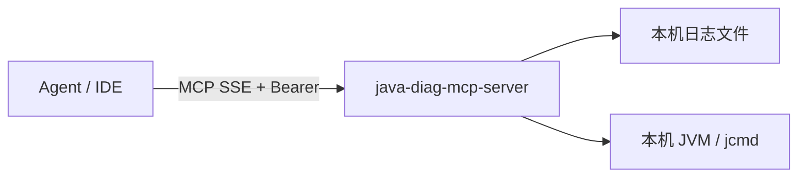

# java-diag

只读、可审计的 Java 线上排查 MCP。

- **探针** `java-diag-mcp-server`：部署在业务机，HTTP MCP（也可 `--stdio`）
- **网关** `java-diag-gateway`：集群入口 + 内置心跳注册；Agent 可只连 Gateway，也仍可直连探针
- **平台**：Windows / macOS / Linux（进程发现：Linux 优先 `/proc`，其它平台走 `jps` / `ProcessHandle`）
- **License**：[MIT](LICENSE)（探针与 Gateway 均开源）
- **安全说明**：[SECURITY.md](SECURITY.md) · **贡献**：[CONTRIBUTING.md](CONTRIBUTING.md)

## 实现原理

**一句话**：诊断能力在探针本机执行；Gateway 只做注册发现与 MCP 工具代理，**自己不跑 jcmd、不读业务日志**。

### 角色

| 角色 | 做什么 | 不做什么 |
|------|--------|----------|
| **Agent**（Cursor 等） | 调 MCP 工具、带 `target` / `pid` | 不直连业务 JVM |
| **Gateway** | 鉴权、心跳 Registry、按 `target` 选节点、把 tool call 转发到探针 | 不采集日志 / JVM |
| **Probe** | 本机进程发现、读白名单日志、`jps`/`jcmd` 等 | 不跨机抓别的节点 |

### 单机（Agent 直连探针）



适合一台机器排查：Agent 配置探针的 `http://host:8765/sse` 即可。

### 集群（Agent 只连 Gateway）


**请求怎么落到具体节点：**

1. 探针启动时带 `--register-url` / `--advertise-url` 向 Gateway 注册，并定期心跳；Registry 里记下 `mcpBaseUrl`（对外可达的探针地址）和本机 `apps[]`（JVM 目录）。
2. Agent 调用工具时带上 `target`（`instanceId` / `mcpBaseUrl` / `serviceName`+`tags`），或先用 `diag.resolve_service` / `diag.list_instances` 选机。
3. Gateway 在 Registry 里解析：
   - **0 个** → `INSTANCE_NOT_FOUND`
   - **多个** → 返回 `candidates`，**不静默选机**
   - **正好 1 个** → 作为 MCP 客户端，短连接该探针的 `mcpBaseUrl`，转发去掉 `target` 后的参数并原样回传结果（含 `routedInstanceId`）

```text
Agent ──MCP──▶ Gateway ──选节点──▶ Probe MCP ──本机执行──▶ 日志 / jcmd
                 ▲                    │
                 └──── 心跳注册 ───────┘
```

因此：**网络上 Gateway 必须能访问各探针的 advertise 地址**；K8s 场景通常每 Pod 挂 Sidecar 探针（见 [`deploy/k8s/README.md`](deploy/k8s/README.md)）。

更细的模块与工具约定见 [`docs/TECH_ARCHITECTURE.md`](docs/TECH_ARCHITECTURE.md)。

## 构建

```bash
mvn -q clean package
```

产物（fat jar，**不入库**；发版请用 CI artifact / GitHub Release）：

- `java-diag-mcp-server/target/java-diag-mcp-server.jar`
- `java-diag-gateway/target/java-diag-gateway.jar`

本地脚本目录 `deploy/java-diag-*/` 需要自行拷贝 jar：

```bash
cp java-diag-mcp-server/target/java-diag-mcp-server.jar deploy/java-diag-mcp-server/
cp java-diag-gateway/target/java-diag-gateway.jar deploy/java-diag-gateway/
```

Docker（先 `mvn package`）：

```bash
docker build -f deploy/Dockerfile.probe -t java-diag-mcp-server:local .
docker build -f deploy/Dockerfile.gateway -t java-diag-gateway:local .
```

## 配置

全部 CLI / 环境变量（传输、host/port、token、日志白名单、超时、输出上限、危险工具、审计路径、注册与 TTL 等）见：

**[docs/CONFIGURATION.md](docs/CONFIGURATION.md)**

```bash
java -jar java-diag-mcp-server.jar --help
java -jar java-diag-gateway.jar --help
```

示例 properties（模块内 `src/main/resources/*.properties.example`）复制到工作目录或 `--config` 指定。

加载顺序：**内置默认 → properties 文件 → 环境变量 → CLI**。

## 单机探针

```bash
cp java-diag-mcp-server/src/main/resources/java-diag-mcp-server.properties.example \
   ./java-diag-mcp-server.properties
# 编辑 auth.token / register.token（必填，勿用占位值）、allowed.log.dirs 等
java -jar java-diag-mcp-server/target/java-diag-mcp-server.jar \
  --config ./java-diag-mcp-server.properties
```

Agent 直连：

```json
{
  "mcpServers": {
    "java-diag": {
      "url": "http://10.0.1.11:8765/sse",
      "headers": { "Authorization": "Bearer YOUR_PROBE_TOKEN" }
    }
  }
}
```

## 集群（心跳注册）

### 1) 启动 Gateway

```bash
java -jar java-diag-gateway/target/java-diag-gateway.jar \
  --config ./java-diag-gateway.properties
```

`auth.token` 与 `register.token` 均为必填（空则启动失败）；探针与网关的 `register.token` 须一致。

**管理控制台**（浏览器查看已注册探针）：`http://<gateway-host>:8787/admin/`  
账号由 `admin.user` / `admin.password` 配置（示例里为占位 `CHANGE_ME_*`，部署前必须改掉）。

### 2) 启动探针并注册

`--service-name` / `JAVA_DIAG_SERVICE_NAME` 可选（默认本机主网卡 IP）。**无** `--instance-id`：实例身份由 `--advertise-url` 的 `host:port` 推导（与 Registry `mcpBaseUrl` 一致）。

```bash
java -jar java-diag-mcp-server/target/java-diag-mcp-server.jar \
  --config ./java-diag-mcp-server.properties \
  --register-url http://gateway-host:8787 \
  --advertise-url http://10.0.1.11:8765
```

### 3) Agent 只连 Gateway

```json
{
  "mcpServers": {
    "java-diag-cluster": {
      "url": "http://gateway-host:8787/sse",
      "headers": { "Authorization": "Bearer YOUR_AGENT_TOKEN" }
    }
  }
}
```

剧本（按 JVM / 业务名）：

1. `diag.resolve_service` `{ "name": "order-service", "tags": { "env": "prod" } }` → 唯一命中得 `suggestedTarget`；多命中看 `candidates`
2. 带 `target`（`instanceId` / `mcpBaseUrl`）+ `pid` 调用 `diag.thread_dump`、`diag.cpu_sample` 等

也可：`diag.list_instances`（支持 `app` / `serviceName` 过滤）→ 多命中时看 `candidates` → 再指定 `target`。  
**多副本不会静默选机。**

探针侧可用 `JAVA_DIAG_APP_NAME_MAP` / `--app-map` 把 jar/mainClass 映射为 `apps[].name`，便于按业务名解析。

## 锁定决策（集群）

| 项 | 结论 |
|----|------|
| 发现 | 心跳注册（Built-in Registry） |
| Gateway | 独立 jar（与探针同为 MIT） |
| 直连探针 | 允许 |
| 多副本 | 返回 candidates，Agent 选 |
| 鉴权 | `auth.token`（Agent/MCP）与 `register.token`（`/registry/*`）均必填且不可为空 |

架构细节：[docs/TECH_ARCHITECTURE.md](docs/TECH_ARCHITECTURE.md) · 配置全集：[docs/CONFIGURATION.md](docs/CONFIGURATION.md) · K8s 草稿：[deploy/k8s/README.md](deploy/k8s/README.md)

## 工具（探针）

Meta / Logs / JVM：`diag.ping`、`diag.list_processes`、`diag.resolve_java_pid`、`diag.log_paths`、`diag.tail_log`、`diag.grep_log`、`diag.cluster_errors`、`diag.runtime_summary`、`diag.jstat`、`diag.thread_dump`、`diag.vm_flags`、`diag.gc_histo`、`diag.vm_info`、`diag.heap_dump`、`diag.cpu_sample`。  
Gateway 另提供 `diag.list_instances`、`diag.resolve_service`，并代理上述探针工具。

## 测试

```bash
mvn -q test
```

CI：`.github/workflows/ci.yml`（JDK 17 / 21）。

## License

[MIT](LICENSE)
